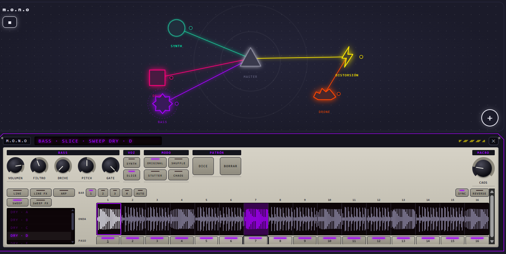

# m.o.n.o

**music orchestration & noise operation**

A web app for making live electronic and experimental music. Build a canvas of nodes (drums, bass, synth, drone, distortion, LFO), wire them together with real audio cables around a fixed MASTER, and edit each one from a TR-909-style hardware panel with a neon frame.

**Try it:** [https://monolive.vercel.app](https://monolive.vercel.app)



No account, no install, no backend. Everything runs in your browser.

---

## What you can do

- Hit **+**, add a node, and it starts playing on its own.
- **Drag** nodes around the canvas and **connect them with cables**. Every cable is a real audio connection: it is created and cut live without interrupting the sound, and changes take effect on the next bar.
- Generate patterns with one button (**DICE**) using reproducible seeds: random, riot, evolve, minimal, dense, human, glitch, euclid.
- Modulate parameters with an LFO, dirty everything up with distortion, play the LEAD from your keyboard, and push the DRONE around with the X/Y pad.
- **Save, load and share** your patch with a link.

## The nodes

Up to 7 nodes, one per type, plus the MASTER in the center.

| Node              | What it is                                                                                                                               |
| ----------------- | ---------------------------------------------------------------------------------------------------------------------------------------- |
| **DRUM**          | 16-step x 4-row sequencer with 8 sample kits and DICE generators.                                                                        |
| **BASS**          | SYNTH mode (303-style voice with PolyBLEP, ladder filter, accent and slide) and SLICE mode (loops cut into 16 pieces you can rearrange). |
| **SYNTH**         | Polyphonic sequencer.                                                                                                                    |
| **LEAD**          | Mono keyboard for playing live, starting from C.                                                                                         |
| **DRONE / NOISE** | Drone and noise layers controlled with an X/Y pad.                                                                                       |
| **DISTORSION**    | Effect you chain into the signal path.                                                                                                   |
| **LFO**           | Modulates the main parameter of whatever node you connect it to.                                                                         |
| **MASTER**        | Levels, reverb, delay, BPM (40 to 300, in steps of 1) and metronome.                                                                     |

Everything plays by itself except the LEAD (live) and the DRONE pad.

## Patches

A patch is a full snapshot of the canvas: nodes, positions, cables, patterns, knobs, BPM, scale, kit and levels.

- **SAVE / LOAD**: stored in your browser (IndexedDB). You can rename and delete.
- **EXPORT / IMPORT**: `.mono` files to move patches between devices.
- **SHARE**: copies a link with the compressed patch inside (`#p=...`). It never touches a server: the patch travels in the link and is rebuilt in the browser of whoever opens it.

Format and validation details in docs/PATCHES.md.

## How it's built

- Strict **TypeScript**, **Vite**, **Lit** (Web Components) for the panels, **SVG** for the canvas. No React, no Tone.js.
- **Web Audio API + AudioWorklet** for the engine. A single lookahead clock against `AudioContext.currentTime`.
- The musical core (`src/core`) is pure TypeScript, with no DOM and no Web Audio, and is tested on its own.
- Audio is decoupled behind the `AudioBackend` interface, so DSP can be swapped out node by node (for example with Rust/WebAssembly later).
- Tests: **Vitest** for core, state and samples; **Playwright** for interaction, real audio and visual parity against the prototype.

## Development

Requires Node 22.12 or newer.

```bash
npm install
npx playwright install chromium   # once, for the browser tests
npm run dev                       # http://localhost:5173
```

| Command             | What it does                                  |
| ------------------- | --------------------------------------------- |
| `npm run dev`       | Development server.                           |
| `npm run build`     | Type check and production build into `dist/`. |
| `npm run typecheck` | Type check only.                              |
| `npm test`          | Unit tests (Vitest).                          |
| `npm run test:e2e`  | Browser tests (Playwright).                   |

## Structure

```text
src/core          pure musical core: clock, generators, scales, routing, patches
src/audio         AudioBackend, Web Audio engine, voices and effects (AudioWorklet)
src/state         app state, actions, patches and the link to the audio engine
src/ui            Lit components: canvas (stage/) and hardware panel (panel/)
public/samples    DRUM kits and BASS loops, with manifest.json
docs              one guide per module
tests             unit/ (Vitest) and e2e/ (Playwright)
reference         original visual prototype
```

## Module docs

BASS · SLICE · SYNTH · LEAD · DRONE · DIST · LFO · ROUTING · PATCHES · SAMPLES · SAMPLES-BASS

Note: the docs and the interface text are currently in Spanish.

## Deploy

Static site on Vercel. Any static host works: run `npm run build` and publish `dist/`.

## Status

Early version (0.1). Designed for desktop, in landscape. Development is tested mainly in Chrome; Safari and Firefox have not been audited yet. If something breaks, open an issue with your browser and what you saw in the console.

## Coming up

- Scenes (slots A to H with morph and song mode).
- MIDI.
- Heavy DSP in Rust/WebAssembly.
- Short links for sharing patches.

## License

All rights reserved
